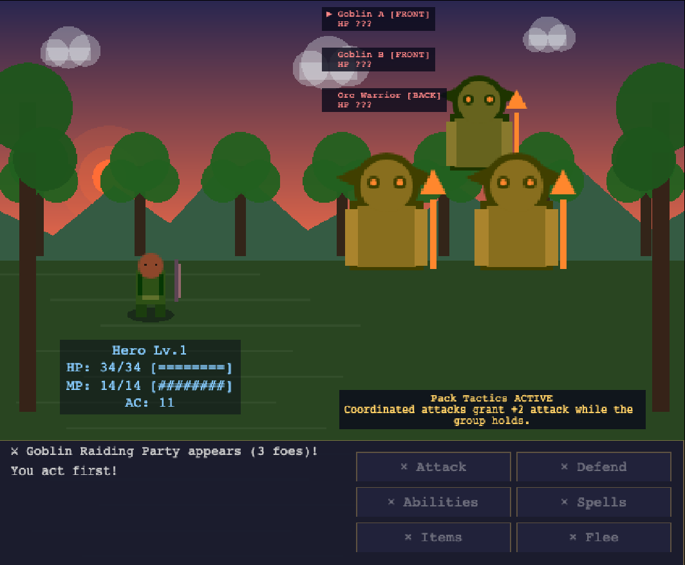

# 2D&D

[](https://github.com/mbianchidev/2dnd/releases/latest)
[](https://github.com/mbianchidev/2dnd/actions/workflows/pr.yml)
[](https://github.com/mbianchidev/2dnd/actions/workflows/deploy.yml)
[](https://github.com/mbianchidev/2dnd/actions/workflows/release.yml)
[](https://github.com/mbianchidev/2dnd/actions/workflows/codeql.yml)
[](LICENSE)

**A single-player browser and desktop JRPG with Dragon Quest-style exploration
and D&D 5E-inspired, turn-based combat.**

Build a hero, recruit a party, cross a 90-chunk world, and complete
the seven-chapter Twelvefold Covenant campaign.



**[Visit the showcase](https://mbianchidev.github.io/2dnd/)** |
**[Play 2D&D now](https://mbianchidev.github.io/2dnd/game.html)** |
**[Download desktop builds](https://github.com/mbianchidev/2dnd/releases/latest)**

Current release: **v1.2.0**

The browser game and Electron desktop app share the same Phaser game.
Pixel-art textures are generated at runtime, and music and sound effects use
Web Audio synthesis rather than external assets. Regions, cities, islands,
and dungeons have distinct procedural scores, with night variations outdoors
and in towns. Campaigns are stored locally; no account is required.

## Highlights

- **Complete a full campaign:** follow the Twelvefold Covenant through 12
  mainland cities, three keystone dungeons, boss encounters, story cutscenes,
  an epilogue, and post-game continuation. Explore connected city districts,
  multi-level dungeons, fog of war, seeded traps, weather, day/night changes,
  non-combat skill checks, and World Events.
- **Build a hero and party:** choose from 12 classes, use 27-point buy or
  4d6-drop-lowest stats, customize appearance, and collect equipment, talents,
  spells, abilities, and mounts. Qualified multiclass choices and six optional
  five-rank prestige paths share the normal level-20 cap. Recruit the Guardian,
  Scout, and Mystic, manage separate equipment and inventories, and control
  their turns manually or with ranked gambits; companions remain single-class.
- **Fight tactical battles:** face up to four enemies with initiative,
  formations, nine elements, status effects, and full-party defeat recovery.
  Match weapons and armor to physical damage types or aim at eligible monster
  parts with accuracy tradeoffs and shared HP. Pixel-art dice show the actual
  resolved rolls without revealing hidden enemy stats or delaying combat.
  Decisions are unlimited by default; optional
  [timed decisions](docs/battle-timing.md) pause for interruptions and use a
  validated Defend timeout.
- **Keep adventuring in New Game+:** preserve a completed manual snapshot and
  create a separate cycle with carried gear, companions, and character knowledge
  in a reset world. NG+-only epic ranks extend progression to level 30, and
  sailing can reveal the secret Starfall Atoll. The completed source remains
  unchanged; see the [carry/reset rules](docs/new-game-plus.md).
- **Take optional detours:** fish, mine, forage, craft recipes and equipment
  upgrades, use merchant routes, earn a boat, explore Tidehaven, and challenge
  the Deepwake Kraken. Play Crown & Bones with capped in-game stakes, try
  class-neutral archery or Harbor Regatta, expand the Codex, earn cosmetic
  titles, and replay story scenes in the Chronicle. Alignment, reputation, and
  the original fictional Unfinished Constellation add optional stories without
  requiring an affiliation to finish the campaign.

See the [gameplay guide](docs/gameplay.md) for controls and progression, or
[Tavern and festival activities](docs/minigames.md) for venues, transparent
odds, free practice, capped rewards, and reduced-motion controls.

## Play in a browser or on desktop

Use a current desktop or mobile browser with JavaScript enabled. The
[hosted game](https://mbianchidev.github.io/2dnd/game.html) needs no installation,
Node.js, or account. Release CI validates Chromium; other current evergreen
browsers are expected to work but are not part of the automated browser gate.

For the standalone Electron app, choose an asset for your operating system from
the [official release](https://github.com/mbianchidev/2dnd/releases/latest):

| Platform | Release assets |
| --- | --- |
| macOS, Apple silicon | `mac-arm64.dmg` or `mac-arm64.zip` |
| macOS, Intel | `mac-x64.dmg` or `mac-x64.zip` |
| Windows, x64 | `windows-x64-setup.exe` or `windows-x64-portable.exe` |
| Linux, x64 | `linux-x86_64.AppImage` or `linux-x64.tar.gz` |

Asset names include the `2D-and-D-<version>-` prefix. Desktop packages are
unsigned, and macOS packages are not notarized, so the operating system may
warn or block the first launch. See the [desktop guide](docs/desktop.md) for
installation, diagnostic logs, security, and packaging details.

### macOS installation and launch help

Download the macOS **arm64** build for Apple silicon or **x64** for Intel from
the [official GitHub Releases page](https://github.com/mbianchidev/2dnd/releases/latest).
Open the DMG or extract the ZIP, then drag `2D-and-D.app` into `/Applications`.

If macOS blocks this unsigned app, only proceed if you **trust the download**
and have verified it came from that official release page. Open Terminal and run:

```bash
xattr -dr com.apple.quarantine "/Applications/2D-and-D.app"
```

This removes quarantine recursively from this app bundle only; it does not
verify its safety. Reopen `2D-and-D.app` from Applications afterward.
Keep Gatekeeper enabled; do not disable it globally. See the
[desktop installation guide](docs/desktop.md#install-and-open-on-macos) for details.

## Run locally

### Prerequisites

Install **Git**, **Node.js 26.12.1 with npm** ([`.nvmrc`](.nvmrc), the CI baseline),
and a current browser. No database, API keys, or application server are needed.
Desktop development additionally requires an operating system supported by Electron;
packaging is documented in the [desktop guide](docs/desktop.md#packaging).

### Install and start

```bash
git clone https://github.com/mbianchidev/2dnd.git
cd 2dnd
npm ci
npm run dev
```

Vite prints its local URL, normally <http://localhost:3000/>. Open that address
for the showcase, then select **Play in browser**, or open
<http://localhost:3000/game.html> directly. If port 3000 is busy, use the port
Vite prints.

You should see the 2D&D title screen. Select **New Game** and follow
**Name -> Class -> Stats -> Appearance -> Adventure**. The opening scenes lead
into a five-step tutorial; **F1** reopens Tips during exploration.

To run the same game in Electron, use `npm run dev:desktop` instead.
`npm run package:desktop` creates unsigned artifacts for the current host.

### Build and preview

```bash
npm run build          # Type-check and build the web showcase and game in dist/
npm run preview        # Serve that production web build locally
```

Use the URL printed by the preview server, normally
<http://localhost:4173/>, with `game.html` for the game. Serve `dist/` over
HTTP(S); do not open the HTML files directly with `file://`.

Vite uses `/` locally and `/2dnd/` in GitHub Actions by default.
Set `VITE_BASE_PATH` when building for another hosting path. Desktop builds
always use relative paths. See [Getting started](docs/getting-started.md) for
hosting and troubleshooting.

### Development checks

```bash
npm audit              # Check the locked dependency installation
npm run typecheck      # Strict TypeScript validation
npm test               # Full Vitest suite
npm run test:browser   # Full Playwright/Chromium suite
npm run test:desktop   # Production-like Electron smoke suite
npm run build:desktop  # Type-check and build the desktop renderer and shell
npm run benchmark:baseline # Production startup, sizes and measured frame work
```

Install Chromium once before the browser or desktop suites with
`npm run test:browser:install`.

Performance receipts retain raw samples and host load; PR CI compares clean base
and head builds on one runner. Independent PR checks overlap behind one complete
gate, retaining full coverage, bounded isolated workers and five browser shards.
See [Testing](docs/testing.md).

## Controls and settings

| Keyboard | Action |
| --- | --- |
| `WASD` | Move during exploration |
| `Space` | Interact; confirm where prompted |
| `Enter` | Confirm menus where prompted |
| `Esc` | Open the menu or cancel an overlay |
| `F1` | Open Tips during exploration |

Pointer, touch, and standard gamepads are supported. The gamepad's right stick
moves a cursor for pointer-first controls. Desktop builds hide mobile control
rails. Mappings are fixed rather than user-remappable; see the
[full control reference](docs/gameplay.md#core-controls).

Open **Settings** from the title screen or in-game menu for audio, text at
100%/125%/150%, high contrast, reduced motion, cutscene advance, dice display,
and prompt preferences. Dice motion can be skipped; attack criticals and
fumbles remain visible even when ordinary dice displays are Off.
Choose Story, Standard, Veteran, Legendary, or bounded Custom rules during
creation; later changes require safe exploration and explicit confirmation.
[Campaign rules](docs/difficulty.md) and [Battle Timing](docs/battle-timing.md)
are separate from accessibility settings. Feature-specific menus and shortcuts
appear as you discover their systems, rather than all being available at once.

## Saves and limitations

Each browser or desktop profile has **one autosave and three named manual
slots**, with per-slot backup recovery and validated JSON import/export.
Use **Esc > Save Game** for a manual snapshot, **Save & Return to Title** for
the autosave, and **Load / Manage Saves** on the title screen to manage or
export campaigns. Export important saves before clearing data or moving devices.

Saves stay in local storage. The hosted site, a local development server, and
the packaged desktop app (`app://2dnd`) use separate origins and do not share
saves automatically. Transfer campaigns with JSON export/import. Clearing site
data, deleting desktop user data, changing profiles, or using private browsing
can remove or hide saves. If storage is blocked, the game reports that campaigns
cannot be saved. Invalid imports cannot overwrite valid campaigns.
Audio/accessibility and inventory-view preferences are stored separately from
campaigns. There is no account system, analytics, or server-side save service.

Steam distribution is **preparation work, not a published Steam release**.
Depot-preview tools and controller/reinstall equivalents exist, but Steam SDK,
Steam achievements, Steam Cloud, and native Steam Input API integration remain
disabled. No Proton support or Deck Verified status is claimed; see
[Steam preparation](docs/steam.md) for outstanding client, hardware, and human
release gates.

## Documentation

| Guide | Contents |
| --- | --- |
| [Documentation index](docs/README.md) | Complete documentation map |
| [Getting started](docs/getting-started.md) | Installation, local hosting, saves, troubleshooting |
| [Gameplay](docs/gameplay.md) | Controls, campaign, combat, exploration, accessibility |
| [Hero progression](docs/hero-progression.md) | Multiclass prerequisites, rest choices, resource rules, lossless hero saves |
| [Prestige paths](docs/prestige.md) | Six optional traditions, qualification, complete rank tables, gear and tradeoffs |
| [New Game+](docs/new-game-plus.md) | Protected source snapshots, carry/reset policy, epic ranks, Starfall Atoll |
| [Architecture](docs/architecture.md) | Scene flow, domain ownership, input, transitions, procedural assets |
| [Development](docs/development.md) | Conventions, feature placement, debug tools, dependencies |
| [Testing](docs/testing.md) | Vitest, Playwright, layout/accessibility checks, CI gates |
| [Save system](docs/save-system.md) | Schema v27, slots, migration, recovery, persistence rules |
| [Difficulty and Custom rules](docs/difficulty.md) | Profiles, bounds, economy, recovery, eligibility, extension APIs |
| [Physical combat](docs/physical-combat.md) | Weapon types, monster sizes, aimed parts, local defenses and discovery |
| [Fictional devotion](docs/devotion.md) | Original pantheon, temples, rites, independent scores, optional stories |
| [Desktop application](docs/desktop.md) | macOS installation, Electron security, storage, development, packaging |
| [Steam preparation](docs/steam.md) | Depot previews, controller equivalent, disabled services, store/human release gates |
| [Release](docs/release.md) | GitHub Pages and release checklist |
| [Companions and gambits](docs/companions.md) | Party state, recruitment, AI, combat integration |
| [Inventory presentation](docs/inventory.md) | Ownership-safe sorting, filtering, controls, transfers |
| [Tavern and festival activities](docs/minigames.md) | Dice, archery, regatta, personal boards, local economy |
| [Dice presentation](docs/dice-presentation.md) | Exact resolved dice, discovery policy, controls, runtime logs |
| [Procedural audio](docs/audio.md) | Location-aware music, synthesized sound, preferences, cleanup |

## Contributing

Bug reports, documentation fixes, and feature proposals are welcome.
Read [AGENTS.md](AGENTS.md), the
[development guide](docs/development.md), and the
[testing guide](docs/testing.md) before changing the game. Open an
[issue](https://github.com/mbianchidev/2dnd/issues) for bugs or proposals and
submit changes through a pull request. Maintainers should follow the
[release guide](docs/release.md) before publishing Pages or desktop builds.

## License

2D&D is licensed under the
[GNU Affero General Public License v3.0 only](LICENSE) (`AGPL-3.0-only`).
